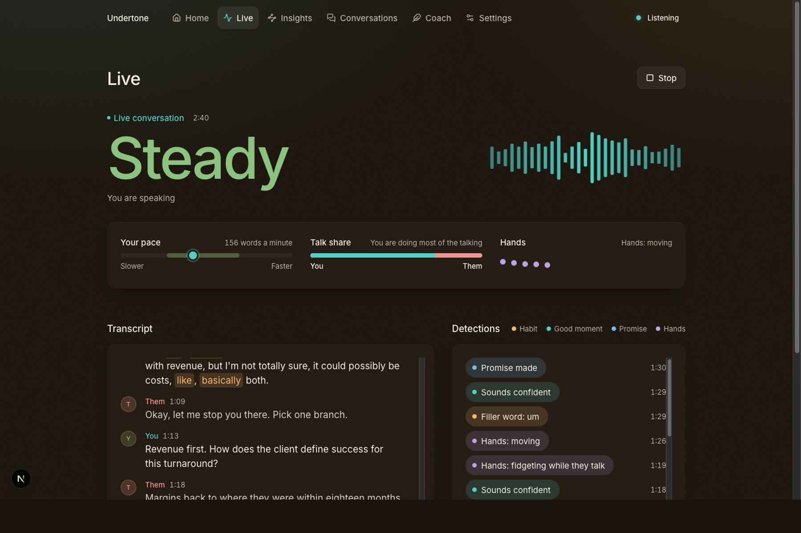
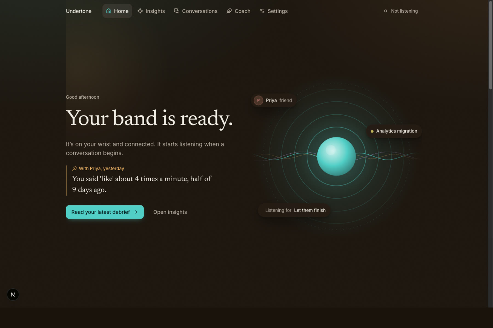
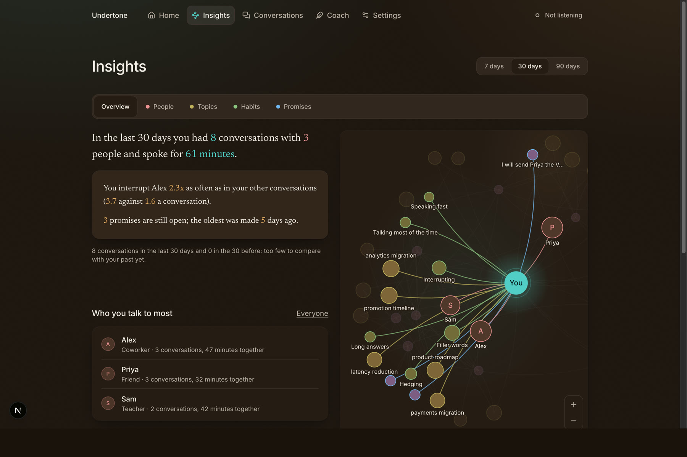
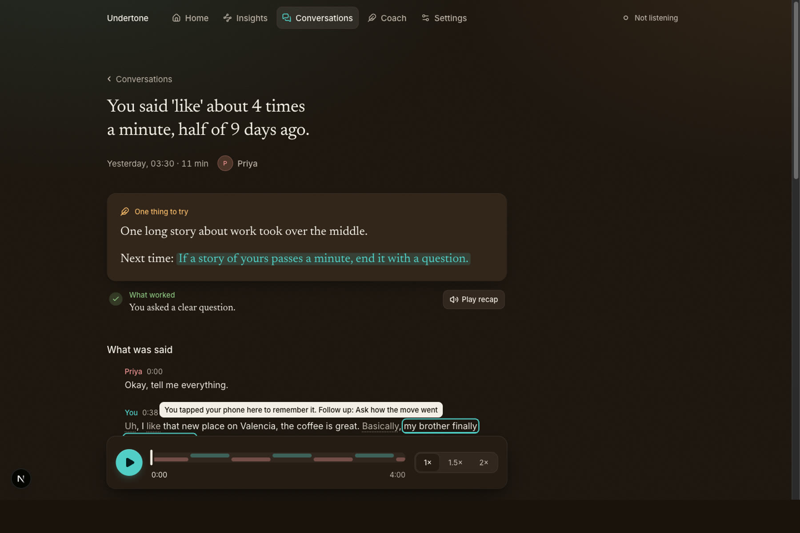
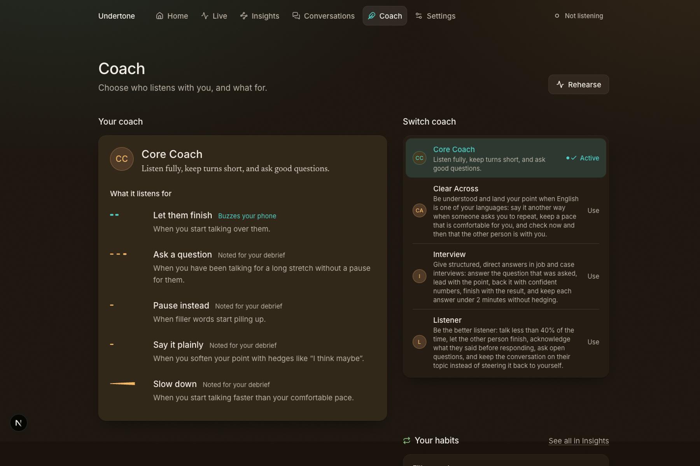

# Undertone

A wearable speech coach that listens to your conversations and nudges you, silently, while they happen.

Built at Vexo Hacks 2026 by Ronit, Dylan Brown and Ash.



| Home | Insights map |
|---|---|
|  |  |

| A conversation's debrief | Coach |
|---|---|
|  |  |

## At a glance

- **Wear it.** A Vexo band on your wrist streams its microphone and motion sensors to your laptop.
- **Get nudged live.** Deepgram transcribes as you speak, Google Gemini judges each turn, and your
  phone buzzes silently when you rush, ramble or lean on filler words.
- **Review afterwards.** Every conversation gets a debrief with one thing to try.
- **Practise out loud.** A spoken coach (Deepgram Voice Agent) interviews you and gives a score and
  simple goals.
- **See the bigger picture.** Voice memory recognises people across conversations and builds a map
  of the people, topics, habits and promises in your life.

## The problem

Most of us only find out how we came across after the conversation is over: we talked too long,
interrupted, filled every pause with "um", or never asked a question. Coaching usually means
recording yourself and watching it back later, which almost nobody does.

## What Undertone does

You wear a Vexo band on your wrist. It hears the conversation and feels your hand movement. A
laptop backend transcribes the conversation in real time, judges each of your turns against the
coach you picked, and, when it matters, sends a short silent haptic pattern to your iPhone. After
the conversation you get a debrief with one thing to try next time, and over time Undertone
remembers the people you talk with and the habits you are working on.

## Features

### Live coaching

- **Always-on capture** (`ALWAYS_ON=1`): the band listens from the moment it connects; a
  conversation opens on the first finished turn and closes after a stretch of silence.
- **Real-time transcript** of both speakers, with filler words kept.
- **Silent nudges**: haptic patterns (tap, interrupt, filler, wrap up, slow down, ...) sent to the
  phone, limited by a per-session budget, a minimum gap and a cooldown. Rules that fire but do not
  buzz are shown as quiet marks. A single tap on the band asks "how am I doing?" and snoozes a
  nudge that just fired.
- **Live metrics**: talk ratio, words per minute, monologue length, fillers.
- **Hand and motion tracking**: the band's motion sensors are classified as still, gesture or
  fidget, including fidgeting while the other person speaks.

### After the conversation

- **Debrief** with one thing to try, written by Gemini and also spoken (Deepgram text-to-speech MP3).
- **Recording and transcript** of each kept conversation (`/sessions/{id}/audio`, `/sessions/{id}/transcript`).

### Memory

- **Voice memory**: speaker embeddings recognise the same people across conversations, and fix the
  "me" / "other" labels once a conversation ends. You can name, merge or delete voices.
- **Relationship labels**: what each person is to you (friend, boss, family, ...) is inferred from
  how the two of you talk; you can override it.
- **Insights map**: a knowledge graph of people, topics, habits and promises, with promises you can
  mark done.
- **Reports**: overview, by person, by topic, habits and promises over a window of days, compared
  with the previous window.
- **Growth**: habit profile, daily mission, streak, weekly report.

### Coaches

- **Build a coach from one sentence** (`POST /coaches/build`): Gemini turns a goal like "I want to
  stop interrupting in meetings" into a validated coach (rules, haptics, judge questions).
- Prebuilt coaches, a personal coach built from your own habit profile, and a practice mode.

### Practice with your coach

- **Spoken practice** (`/coach/practice` on the website): the coach asks questions out loud through
  the Deepgram Voice Agent, you answer by microphone, and it replies with short follow-ups.
- **Score and goals**: measured sub-scores (pace, clarity, conciseness, confidence, getting started)
  come from your actual words and timings; Gemini judges structure. You get an overall score and a
  few concrete goals, which the next session checks.
- **Demo Day coach**: a built-in hackathon-judge coach that asks what you built, who it is for, how
  it works, what was hardest and what is next.

### Calibration

- **Teach it your voice** (Settings, Calibration): read a short passage for 15 seconds so it knows
  your voice from other people's, then re-label earlier conversations.
- **Teach it your hands**: 15 seconds of still, gesturing and fidgeting.

### Phone app

- Expo app for iPhone (runs in Expo Go): pairs with the backend, plays the haptic nudges, shows the
  debrief and transcript, and lists third-party apps allowed to send haptics.

## How it works

```text
 Vexo band (mic + motion)
        |
        | BLE (Vexo Open kit)
        v
 Laptop backend (Python, FastAPI)
        |-- audio --> Pipecat --> Deepgram streaming STT --> turns + transcript
        |-- motion --> classifier (still / gesture / fidget)
        |
        v
 Brain: turn -> Gemini judge (rule fallback) -> metrics -> nudge engine
        |                        |                         |
        |                        v                         v
        |            debrief (Gemini text,       haptic nudge over WebSocket
        |            Deepgram spoken MP3)        --> iPhone app (Expo)
        v
 SQLite: sessions, turns, voices, people, relationships, graph
        |
        | REST + WebSocket /ws
        v
 Website (Next.js): Home, Live, Insights, Conversations, Coach, Settings
```

**Vexo band and Open kit.** The band streams microphone audio, motion and taps. The backend loads
the Vexo Open kit's Python `Band` from a local clone (`vexo-open-kit/`) and connects over BLE
(serial is also supported). The motion stream drives the still / gesture / fidget classifier, and
taps become "how am I doing?" and bookmarks.

**Deepgram.** Streaming speech-to-text through Pipecat, one worker per conversation. The default
model is Nova-2 because, on our two-voice test audio, it kept the "um"s that Nova-3 dropped; the
model can be changed with `STT_MODEL`. It uses `filler_words`, diarization (optional
`DIARIZE_MODEL`), interim results for the live transcript, and coach vocabulary (keyterm prompting
on Nova-3). Flux end-of-turn detection is available behind `USE_FLUX`. Deepgram Aura-2 speaks the
debrief.

**Google Gemini.** Gemini 3.8 Flash with structured (JSON schema) output, via `backend/llm.py`.
It judges each of your turns against the coach's questions (Gemini Decisions API, one call per
turn), writes the debrief, builds coaches from one sentence, infers relationship labels, and
extracts and merges topics for the Insights map. Every one of these has a rule or keyword fallback,
so the app keeps working when Gemini is slow, fails, or has no key.

**Other pieces.**
- **Pipecat** runs the Deepgram pipeline.
- **sherpa-onnx** with the TitaNet-small model computes speaker embeddings for voice memory.
- **SQLite** stores everything locally (`undertone.db`).
- **Next.js** website and **Expo** (React Native) phone app.
- `contracts/events.ts` is the source of truth for every event on the WebSocket; `backend/contracts.py` mirrors it.
- `sdk/undertone-haptics.js` lets other apps request haptics once you approve them (`/v1/apps`, `/v1/haptics`).

## Repo layout

| Folder | What is in it |
|--------|---------------|
| `backend/` | FastAPI app: band, speech-to-text, judge, nudges, debrief, voices, relationships, graph, reports, coaches |
| `dashboard/` | Next.js website |
| `mobile/` | Expo iPhone app |
| `contracts/` | Shared event types (`events.ts`) |
| `sdk/` | JavaScript haptics SDK for third-party apps |
| `scripts/` | Replay, rehearsal, evals, smoke tests, seeding and reset tools |
| `fixtures/` | Recorded sessions, demo scripts, judge test cases, audio fixtures |
| `prompts/` | Prompts used while building |
| `plan.md`, `AGENTS.md`, `DESIGN.md` | Plan, contributor notes and design system |

## Run it

### Prerequisites

- macOS laptop with Bluetooth, Python 3.13 and [uv](https://docs.astral.sh/uv/)
- Node.js and npm
- iPhone with Expo Go, on the same Wi-Fi as the laptop
- A Vexo band (optional, see below)
- The Vexo Open kit cloned into the repo root:
  `git clone --depth 1 https://github.com/VexoAI-Org/vexo-open-kit`

### Environment

Copy `.env.example` to `.env` in the repo root and fill in what you have. Never commit real keys.

| Variable | What it is for |
|----------|----------------|
| `DEEPGRAM_API_KEY` | Live speech-to-text and the spoken debrief |
| `GEMINI_API_KEY` | Judge, debrief, coach builder, relationships, topics |
| `ANTHROPIC_API_KEY`, `OPENAI_API_KEY`, `ELEVENLABS_API_KEY` | Optional, listed in `.env.example` |
| `PUBLIC_BACKEND_URL` | Address the phone uses, e.g. `http://<laptop-ip>:8000` |
| `VEXO_BAND_NUMBER` | The number on your band's bag |
| `BAND_TRANSPORT` | `ble`, `serial`, `sim` or `laptop-mic` |
| `SIM_WAV` | WAV file the simulated band plays when `BAND_TRANSPORT=sim` |
| `ALWAYS_ON` | `1` to listen from band connect; tune with `ALWAYS_ON_SILENCE_S`, `ALWAYS_ON_MIN_TURNS` |
| `USE_RULE_JUDGE_ONLY` | Skip Gemini and always use the rule judge |
| `STT` | `deepgram` (default), `fake` (scripted speech, no network) or `off` |
| `STT_MODEL`, `USE_FLUX`, `DIARIZE_MODEL` | Deepgram model and options |
| `DEMO_POLICY` | Demo nudge policy: every rule may buzz, shorter gap, bigger budget |
| `DEV` | Enables `POST /dev/publish` for injecting test events |
| `UNDERTONE_DB` | SQLite path (default `undertone.db`) |
| `UNDERTONE_ENV_FILE` | Extra env file to load (useful in git worktrees) |

### Backend

```bash
uv sync
BAND_TRANSPORT=ble ALWAYS_ON=1 uv run uvicorn backend.main:app --host 0.0.0.0 --port 8000
```

Check `http://localhost:8000/health`. If the band does not connect, the server keeps running and
retries in the background; `/health` says why.

### Website

```bash
cd dashboard && npm install && npm run dev
```

Open `http://localhost:3000`.

### Phone

```bash
cd mobile && npm install && npx expo start
```

Scan the QR code with the iPhone camera to open it in Expo Go. Pair the phone from the website's
Settings page, then calibrate your voice in **Settings -> Calibration** so Undertone can tell you
apart from the other speaker.

### Without a band or without keys

- **No band**: `BAND_TRANSPORT=sim SIM_WAV=path/to/file.wav` plays a WAV as if the band heard it,
  or `BAND_TRANSPORT=laptop-mic` uses the laptop microphone.
- **No Gemini key**: the rule judge and keyword fallbacks take over (`USE_RULE_JUDGE_ONLY=true` forces it).
- **No Deepgram key**: no live transcription and no spoken debrief; `STT=fake` uses scripted speech.
- **Fully offline demo**: `uv run python scripts/rehearse.py` runs the whole demo in-process with
  no band, Deepgram or Gemini.
- **Replay a recorded session** against a running backend: `uv run python scripts/replay.py --speed 4`.
- **Sample history**: `uv run python scripts/seed_sample.py` fills past conversations for the
  Insights and Conversations pages.
- **Start fresh**: `scripts/reset_data.sh` stops the backend, moves the database and recordings to a
  dated backup folder (nothing is deleted) and starts it again.

## Tests

```bash
uv run pytest
cd dashboard && npm test
```

## Privacy and limits

- Undertone records speech, including other people's. Tell the people you talk with, and follow the
  recording laws where you are.
- Everything is stored locally on the laptop (SQLite and audio files). Audio goes to Deepgram and
  transcript text goes to Gemini when those keys are set.
- There is no user login. Run it on a private network you trust; anyone who can reach the backend
  can read its data.
- Speaker labels during a live conversation can be wrong; they are corrected after the conversation ends.
- This is a hackathon prototype, not a finished product.
